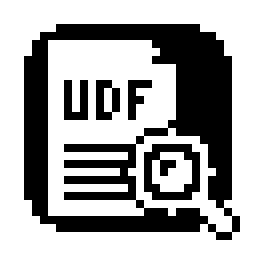

<p align="center"></p>

<h1 align="center">UDF Viewer</h1>

<p align="center"><b>Avukatlar için macOS'te UYAP .udf evrakını boşluk tuşuyla (Hızlı Bakış) gösteren, ücretsiz ve açık kaynak eklenti.</b></p>

---

## Neden?

Mac'te bir PDF'i ya da resmi görmek için Finder'da seçip **boşluk tuşuna** basmak yeter. UYAP'ın `.udf` evrakında ise bu çalışmaz: dilekçeye, tutanağa ya da karara göz atmak için her seferinde UYAP Doküman Editörü'nün açılmasını beklemek gerekir.

**UDF Viewer** bunu düzeltir: Finder'da bir `.udf` seçip boşluğa basarsınız, evrak antetiyle, kalın/altı çizili yazılarıyla, hizalamasıyla ve tablolarıyla anında görünür. Ok tuşlarıyla klasördeki evrakları tek tek gezebilirsiniz.

## Özellikler

- **Boşluk tuşuyla önizleme** — Finder'da, masaüstünde ve dosya seçme pencerelerinde.
- **Biçimiyle** — antet, kalın, italik, altı çizili, yazı boyutu, hizalama, girintiler, sekmeler ve tablolar korunur.
- **Çift tıklama değişmez** — evrak yine UYAP Doküman Editörü'nde açılır; düzenleme ve imza işleri orada sürer.
- **UYAP Editörü kurulu olmasa da çalışır** — yalnızca göz atmak isteyen meslektaşlar için de uygundur.
- **Asıl dosyaya dokunmaz** — yalnızca okur; yanına hiçbir dosya kaydetmez.
- **Kendiliğinden güncellenir** — uygulamayı açtığınızda yeni sürüm varsa sorar, "Yükle" derseniz kendini günceller.

## Gizlilik ve güvenlik

- **Açık kaynaktır.** Programın bütün kodu bu sayfadadır; herkes inceleyebilir.
- **Belgeleriniz bilgisayarınızdan çıkmaz.** Önizleme eklentisi macOS'in korumalı alanında (sandbox) çalışır ve internete hiç bağlanmaz.
- **Uygulama internete tek bir amaçla bağlanır:** açıldığında bu sayfadaki son sürüm numarasını okumak. Bu sırada hiçbir veri gönderilmez.
- Kayıt, hesap, reklam, kullanım istatistiği yoktur.

## Kurulum

> Gereksinim: **Apple Silicon (M1, M2, M3, M4…) işlemcili Mac**, macOS 12 veya üzeri.

Üç yoldan birini seçin. Kutuların sağ üstündeki kopyala düğmesiyle tek tıkla kopyalayabilirsiniz.

### 1. Terminal ile (en hızlısı)

**Terminal** uygulamasını açın (Spotlight'ta "Terminal" yazın), aşağıdaki satırı yapıştırıp Enter'a basın:

```bash
curl -fsSL https://github.com/fthmrl/udf-viewer/releases/latest/download/UdfViewer.zip -o /tmp/UdfViewer.zip && ditto -x -k /tmp/UdfViewer.zip /Applications && xattr -dr com.apple.quarantine "/Applications/UDF Viewer.app" && open "/Applications/UDF Viewer.app"
```

Bu satır son sürümü indirir, **Programlar** klasörüne koyar, macOS'in "geliştirici doğrulanamadı" uyarısını baştan kaldırır ve uygulamayı bir kez açarak önizlemeyi etkinleştirir.

### 2. Claude ile

Mac'inizde [Claude](https://claude.ai/download) (Claude Code) varsa, aşağıdaki metni kopyalayıp Claude'a yapıştırın:

```text
GitHub'daki fthmrl/udf-viewer uygulamasını bu Mac'e kur: https://github.com/fthmrl/udf-viewer/releases/latest/download/UdfViewer.zip dosyasını indir, /Applications klasörüne aç, "UDF Viewer.app" üzerindeki karantina işaretini kaldır ve uygulamayı bir kez açarak Hızlı Bakış eklentisini etkinleştir.
```

### 3. Elle

1. Sağdaki **Releases** bölümünden son sürümün `UdfViewer-vN.zip` dosyasını indirin.
2. Zip'e çift tıklayın, çıkan **UDF Viewer** uygulamasını **Programlar** klasörüne sürükleyin.
3. Uygulamayı bir kez açın. macOS "geliştiricisi doğrulanamadı" uyarısı verirse (program App Store'dan gelmediği için) uyarıyı kapatın, **Sistem Ayarları → Gizlilik ve Güvenlik**'te en altta **Yine de Aç**'a basın.

"UDF Viewer hazır" penceresini gördüyseniz kurulum tamamdır: bir `.udf` seçip boşluğa basın.

### Önizleme görünmüyorsa

**Sistem Ayarları → Genel → Oturum Açma Öğeleri ve Uzantılar → Hızlı Bakış** bölümünde **UDF Viewer**'ın açık olduğundan emin olun, sonra uygulamayı bir kez daha açın.

## Bilinen sınırlar

- Önizleme evrakı tek uzun sayfa olarak gösterir; sayfa sonları ve her sayfada tekrarlanan üst/alt bilgi gösterilmez.
- E-imzalı paketlerin içi açılamazsa kısa bir açıklama görünür; bu evrakları UYAP Doküman Editörü ile açın.
- Intel işlemcili Mac'ler desteklenmiyor.

## Nasıl çalışır?

`.udf` aslında bir zip paketidir; içindeki `content.xml` evrakın metnini ve biçimini tutar. Eklenti bu dosyayı okuyup evrakı bir web sayfası olarak çizer ve Hızlı Bakış'a verir. Kaynak kod: [`udf.swift`](udf.swift) (dönüştürücü), [`onizleme.swift`](onizleme.swift) (Hızlı Bakış eklentisi), [`main.swift`](main.swift) (kurulum ve güncelleme).

Kendiniz derlemek isterseniz Xcode gerekmez, Komut Satırı Araçları yeterlidir: `YALNIZ_KUR=1 ./yayimla.sh 1`

Kardeş proje: [TIFF Viewer](https://github.com/fthmrl/tiff-viewer) — UYAP/EBYS'nin eski tip TIFF belgelerini Önizleme'de açar.

## Görüş, öneri ve hata bildirimi

Bir isteğiniz, öneriniz ya da karşılaştığınız bir sorun varsa:

👉 **[Öneri / istek gönderin ya da hata bildirin](https://github.com/fthmrl/udf-viewer/issues/new)**

> ⚠️ Bu sayfa herkese açıktır; lütfen müvekkil belgesi, dosya numarası ya da kişisel bilgi paylaşmayın.

## Lisans

MIT — özgürce kullanabilir, paylaşabilir ve değiştirebilirsiniz. Ayrıntılar [`LICENSE`](LICENSE) dosyasında.

---

<p align="center">Av. Fatih MERAL · Meral Avukatlık Bürosu</p>
